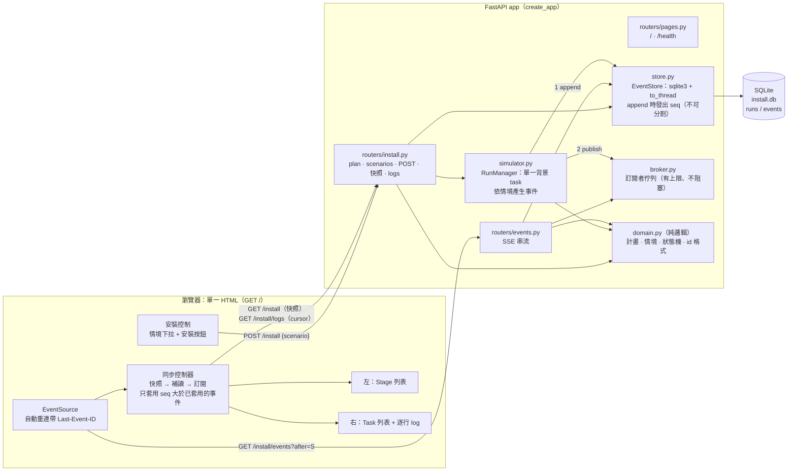
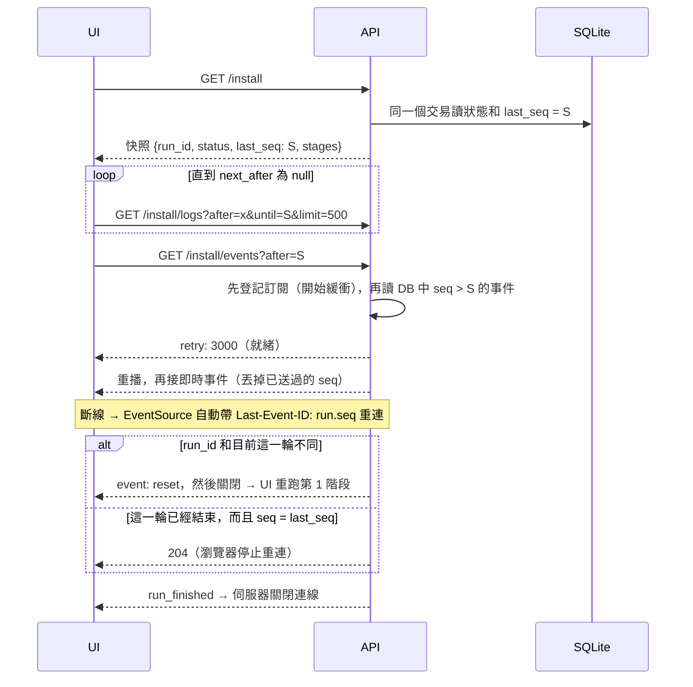
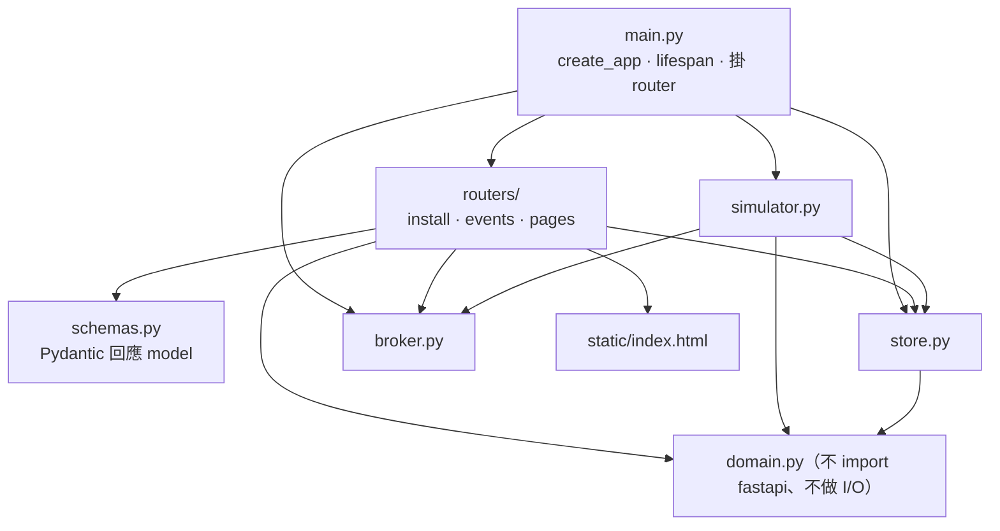
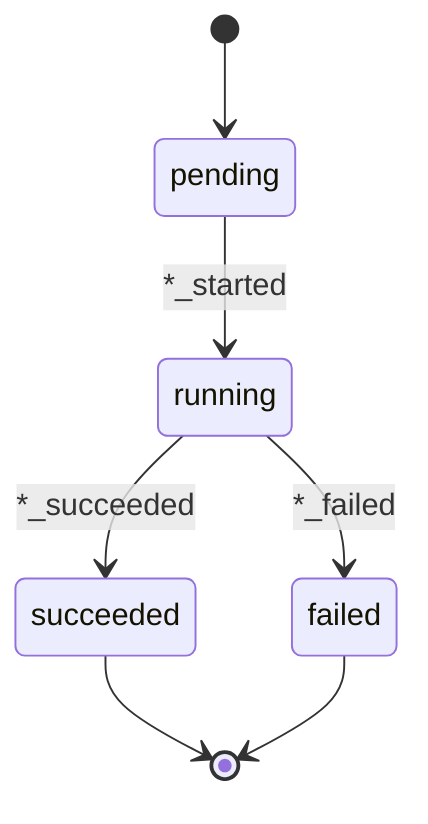

# 計畫（rev 2）：SPEC 改寫為 v1.0「安裝進度即時串流」

> [!NOTE]
> **狀態（2026-11-20 23:16）**：使用者已核准這份計畫，`docs/SPEC.md` v1.0、`contracts/domain.pyi`、`contracts/openapi.yaml` 都已經寫好。使用者指示「**只整理文件，不開始執行**」，所以：
> - `app/main.py`、`pyproject.toml` **沒有修改**（已還原），`create_app` 換成新簽名的工作留給 T2.1。
> - `spec-ws` 裡的 v0.3 已刪除（使用者 23:20 同意）；SPEC 已移到 `docs/SPEC.md`；T1.7 審閱依使用者決定不做。
> - 這份文件是**決策紀錄**；行為以 `docs/SPEC.md` 為準。撰寫 SPEC 時做了以下修正：
>   - `GET /install/logs` 加上必填的 `run_id`，不符時回 `409`。
>   - SSE 第一次連線改用 query `last_event_id=<run_id>.<seq>`，取代 `after`，這樣連換輪都能偵測。
>   - 新增 `GET /stats`，用來觀察斷線後是否釋放資源。
>   - 啟動復原改成**補寫事件**（`task_failed E_INTERRUPTED`、`stage_failed`、`run_finished`），這樣快照仍然等於事件依序套用的結果。
>   - `reset` 在送出之前也會先送 `retry` 區塊；前端收到 `reset` 或 `run_finished` 時要呼叫 `close()`。
>   - 驗收條件重新編號成 AC1–AC12（新增 AC10 慢速訂閱者）。

## 目標

清空 SPEC v0.2（Clock／聊天廣播），依 [install-progress-sequence.svg](file:///Users/oliver/Desktop/projects/SSE/install-progress-sequence.svg) 改寫成 **SPEC v1.0**，並產出 `contracts/`。由**這個 session 直接撰寫**（OQ3）。

> 選擇失敗情境 → 按下「安裝」→ 伺服器模擬安裝（Stage → Task → Log）→ 左側列出 Stage，右側列出目前 Stage 的 Task → 執行中的 Task 透過 SSE 逐行顯示 log，完成後收合，換下一個 → 失敗時停下來，task 和錯誤 log 標紅，並顯示模擬的排除建議 → 中途進入、重新整理或斷線，畫面都能補齊，不漏、不重複。

這次的交付物是**規格與合約**，加上清理既有產出。實作（T2.1）和測試（T2.2）照 Phase 2 之後的流程進行。

### 這一版和 rev 1 的差異
| 項目 | 決定 |
|---|---|
| OQ1 失敗觸發 | ✅ 下拉選單選**失敗情境**（共 7 種，見 §3），每種的結果都可以重現 |
| OQ2 卡住模擬 | ❌ 不做（拿掉 `stall_at`、`task_stalled`、`stall_after`，以及原本的 AC6） |
| OQ3 誰改 SPEC | ✅ 這個 session；PROGRESS 記一筆偏差 **X5** |
| 新增 | §1 架構圖、§2 模組依賴圖 |

---

## User Review Required

> [!IMPORTANT]
> **核心不變式**：每一輪安裝只有**一條**事件序列，`seq` 從 1 開始連續遞增。事件**先寫進 SQLite，再廣播**。快照、補讀 log、SSE 都只是讀取這條序列的不同方式，所以「不漏、不重複、因果順序正確」是結構保證的結果。

> [!WARNING]
> **事件 id 是 `<run_id>.<seq>`**（例如 `3.57`）。重新安裝會清掉上一輪（Q6）；舊分頁帶著上一輪的 id 重連時，伺服器送出 `event: reset`，前端重新同步，不會把兩輪混在一起。

> [!CAUTION]
> **會被作廢或刪除**：SPEC v0.2 的 R1–R22；`~/.local/share/sse-orchestra/spec-ws/` 裡的 v0.3 和 `contracts/`（T1.6，還沒搬回主 repo，會先在 PROGRESS 記錄再刪除）；`app/main.py` 中 `create_app` 的舊參數。

---

## Open Questions

> [!NOTE]
> 主要問題都已經決定。以下細節直接採用建議，除非你反對：
> - 安裝進行中再按安裝 → `409`；按鈕在執行中是 disabled。
> - 右側 Task 列表自動跟著目前的 Stage；點左側其他 Stage 可以查看，畫面停止自動跟隨，按「回到目前進度」才恢復。
> - 點開已收合的 task 可以看 log，**不另發請求**。
> - 前端是單一 HTML、不依賴外部資源、不用 Vue。

---

## 1. 系統架構圖



### 一筆事件的生命週期

```mermaid
sequenceDiagram
    participant Sim as RunManager
    participant Store as EventStore
    participant DB as SQLite
    participant Br as Broker
    participant Sub as 訂閱者（SSE generator）
    Sim->>Store: append(type, data)
    Store->>DB: BEGIN; seq = last_seq+1; INSERT; COMMIT
    Store-->>Sim: Event(run_id, seq)
    Sim->>Br: publish(event)（不阻塞）
    alt 佇列沒滿
        Br->>Sub: queue.put_nowait(event)
        Sub-->>Sub: format → 送給客戶端
    else 佇列滿了
        Br->>Sub: 踢掉（結束連線）
        Note over Sub: 客戶端帶 Last-Event-ID 重連，從 SQLite 補回
    end
```

### 中途進入、斷線、換輪（對應 SVG 的 1、OPT、註 1）



## 2. 模組結構與依賴方向



符合 [AGENTS.md](file:///Users/oliver/Desktop/projects/SSE/AGENTS.md) §5：`domain` 不依賴其他 app 模組；共享物件由 lifespan 建立，放在 `app.state`；背景 task 由 RunManager 持有參考，關閉時取消。

---

## 3. SPEC v1.0 內容

### 3.1 固定的安裝計畫（Q2：按下安裝之前就知道）

| Stage | Tasks（`task_id`：名稱，log 行數） |
|---|---|
| `prepare` 準備環境 | `check_os` 檢查作業系統（8）· `check_disk` 檢查磁碟空間（6）· `check_deps` 檢查相依套件（12） |
| `download` 下載套件 | `fetch_manifest` 取得清單（6）· `download_packages` 下載套件（30）· `verify_checksum` 驗證雜湊（10） |
| `install` 安裝 | `extract` 解壓縮（20）· `copy_files` 複製檔案（40）· `register` 註冊元件（8） |
| `configure` 設定 | `write_config` 寫入設定（10）· `set_permissions` 設定權限（6）· `start_service` 啟動服務（12） |

log 內容由程式決定性地產生（例如 `[copy_files] copying lib/core_017.so (17/40)`），每次執行都一樣，方便測試比對。

### 3.2 失敗情境（OQ1）

| `scenario` | 失敗的 task | 先輸出幾行 log 才失敗 | `error_code` | 錯誤訊息（範例） | 模擬的排除建議 |
|---|---|---|---|---|---|
| `success` | — | — | — | — | — |
| `network_unreachable` | `fetch_manifest` | 0（**一開始就失敗**） | `E_NETWORK` | 無法連線到套件伺服器 | 檢查網路、Proxy 與防火牆設定 |
| `dependency_missing` | `check_deps` | 7 | `E_DEPENDENCY` | 缺少 libssl ≥ 3.0 | 先安裝相依套件後再重新安裝 |
| `checksum_mismatch` | `verify_checksum` | 9（**最後一行之前**） | `E_CHECKSUM` | 套件雜湊值不符 | 清除下載快取後重新下載，或更換鏡像站 |
| `disk_full` | `copy_files` | 23（**中途**） | `E_DISK_FULL` | 磁碟空間不足（剩 0 MB） | 釋放至少 2 GB 空間後重新安裝 |
| `permission_denied` | `set_permissions` | 3 | `E_PERMISSION` | 無法寫入 /etc/app | 以系統管理員權限執行 |
| `service_timeout` | `start_service` | 12（**最後一個 task 的最後一行之後**） | `E_SERVICE_TIMEOUT` | 服務啟動逾時（30 秒） | 查看服務 log，確認連接埠沒有被佔用 |

這幾個情境刻意涵蓋了邊界：第一行之前失敗、中途失敗、最後一行之後失敗、最後一個 task 失敗，以及分布在每個 stage。

失敗時依序送出：一行 `log`（`level: "error"`，內容就是錯誤訊息，前端用紅字顯示）→ `task_failed` → `stage_failed` → `run_finished{result:"failed"}`。後面的 stage 和 task 都維持 `pending`（Q3）。

### 3.3 狀態機


Run 的狀態是 `idle → running → succeeded | failed`。另外規定：伺服器重新啟動時，如果資料庫裡留著 `running` 的那一輪，就把它標成 `failed`，`error_code = E_INTERRUPTED`，避免畫面永遠停在「執行中」。

### 3.4 事件（SSE 的 `event:` 名稱就是事件的 type；`id` 是 `<run_id>.<seq>`；`data` 是單行 JSON）

| type | data |
|---|---|
| `run_started` | `{run_id, scenario}`，`seq = 1` |
| `stage_started` / `stage_succeeded` / `stage_failed` | `{stage_id}` |
| `task_started` / `task_succeeded` | `{stage_id, task_id}` |
| `log` | `{stage_id, task_id, line_no, level: "info" \| "error", text, ts}` |
| `task_failed` | `{stage_id, task_id, error_code, message, hint}` |
| `run_finished` | `{result: "succeeded" \| "failed"}`，最後一筆；送完伺服器就關閉連線 |

控制區塊**不寫進資料庫、不佔用 seq**：`retry: 3000`（第一個區塊，表示就緒）、`: ping`（閒置 `heartbeat_interval` 秒時送出）、`event: reset`（要求重新同步）。

### 3.5 HTTP 介面

| 方法／路徑 | 回應 | 規則 |
|---|---|---|
| `GET /install/plan` | `200 {stages:[{id,name,tasks:[{id,name}]}]}` | 隨時都能呼叫 |
| `GET /install/scenarios` | `200 [{id, label, fail_task_id \| null}]` | 給下拉選單用 |
| `POST /install` `{scenario}` | `202 {run_id}` | 在同一個交易裡清掉上一輪，建立新的一輪；執行中呼叫回 `409`；情境不存在回 `422` |
| `GET /install` | `200 {run_id, status, scenario, last_seq, stages:[{id,status,tasks:[{id,status,error?}]}]}` | 狀態和 `last_seq` 從同一個交易讀出；還沒有任何一輪時回 `404` |
| `GET /install/logs?after=&until=&limit=` | `200 {items:[log event], next_after}` | `after < seq ≤ until`，只回 `log` 事件，依 seq 遞增；`limit` 1–1000，預設 500 |
| `GET /install/events?after=<seq>` | `200 text/event-stream` | `Last-Event-ID` 的優先順序高於 `?after`；id 格式不合法時視同 `after=0`；還沒有任何一輪時回 `404` |
| `GET /` | `200 text/html` | 單一頁面 |
| `GET /health` | `200 {status:"ok"}` | |

SSE 共通規則：header 包含 `text/event-stream`、`Cache-Control: no-cache, no-transform`、`X-Accel-Buffering: no`，不壓縮；客戶端斷線時靠取消機制結束 generator（不吞掉 `CancelledError`），並在 `finally` 裡退訂；lifespan 關閉時取消模擬器並結束所有串流。

### 3.6 SQLite（標準函式庫 `sqlite3`，WAL 模式，所有操作都透過 `asyncio.to_thread`，寫入由 `asyncio.Lock` 依序進行）

```sql
CREATE TABLE runs   (run_id INTEGER PRIMARY KEY, scenario TEXT NOT NULL,
                     status TEXT NOT NULL, last_seq INTEGER NOT NULL DEFAULT 0,
                     started_at TEXT NOT NULL, finished_at TEXT);
CREATE TABLE events (run_id INTEGER NOT NULL, seq INTEGER NOT NULL, type TEXT NOT NULL,
                     data TEXT NOT NULL, ts TEXT NOT NULL, PRIMARY KEY (run_id, seq));
```
`run_id` 在重新安裝時**遞增，不重設**（清空 `events` 和舊的 `runs` 列，但下一個 id 接著用），所以 `reset` 判斷一定有效。

### 3.7 設定 `create_app(...)`（明確傳入的參數 > 環境變數 > 預設值；不合法就拋 `ValueError`）

| 參數 | 環境變數 | 預設 | 合法範圍 |
|---|---|---|---|
| `db_path` | `SSE_DB_PATH` | `./install.db` | 非空字串 |
| `log_interval` | `SSE_LOG_INTERVAL` | 0.15 | 有限數值 0–10 秒（0 = 盡快，測試用） |
| `heartbeat_interval` | `SSE_HEARTBEAT_SECONDS` | 15.0 | 有限正數 |
| `subscriber_queue_size` | `SSE_SUBSCRIBER_QUEUE_SIZE` | 1000 | 整數 ≥ 1 |

### 3.8 前端行為（Q5）

- 固定的元素 id：`#scenario`、`#install-btn`、`#run-status`、`#stage-list`、`#task-list`、`#follow-btn`。每個節點都帶 `data-stage-id` 或 `data-task-id`，以及 `data-status`。
- 執行中的 task 展開並逐行追加 log，自動捲到最底；`task_succeeded` 時收合。
- `task_failed` 時，該 task 和它所在的 stage 標紅、保持展開；錯誤那一行 log 用紅字；下方顯示 `message` 和 `hint`；安裝按鈕恢復可以按。
- 一律用 `textContent`。

### 3.9 `contracts/domain.pyi`（可以直接單元測試的純邏輯）
```python
PLAN: Final[Plan]
SCENARIOS: Final[Mapping[str, Scenario]]


def format_event_id(run_id: int, seq: int) -> str: ...


# "3.57" -> (3, 57)；不合法 -> None
def parse_event_id(raw: str | None) -> tuple[int, int] | None: ...


# 該情境完整的事件劇本（不含 seq、ts）
def script_for(scenario_id: str) -> tuple[ScriptStep, ...]: ...


# 狀態機
def apply_event(state: Snapshot, event: Event) -> Snapshot: ...
def initial_snapshot(run_id: int, scenario_id: str) -> Snapshot: ...
```
`apply_event` 是 AC1 的參照實作，`script_for` 是 AC4、AC5 的預期值來源。

---

## 4. 檔案變更

#### [MODIFY] [SPEC.md](file:///Users/oliver/Desktop/projects/SSE/SPEC.md)
整份重寫成 v1.0（§3 的內容，加上 §6 的驗收條件），需求用 R1… 重新編號；附錄改成「v0.2 → v1.0：主軸改變，舊需求全部作廢」。

#### [NEW] `contracts/openapi.yaml`
8 個端點的形狀；SSE 事件 schema 放在 `x-sse-events`；每個 operation 用 `x-spec-refs` 標出對應的 R-id。

#### [NEW] `contracts/domain.pyi`
§3.9 列出的名稱，以及 `Plan`、`Stage`、`Task`、`Scenario`、`ScriptStep`、`Event`、`Snapshot` 的型別定義（frozen dataclass 或 TypedDict）。

#### [MODIFY] [app/main.py](file:///Users/oliver/Desktop/projects/SSE/app/main.py)
只把 `create_app` 的簽名改成 §3.7 的參數（實作留給 T2.1），附上 `TODO(T2.1)`。

#### [MODIFY] [pyproject.toml](file:///Users/oliver/Desktop/projects/SSE/pyproject.toml)
只改 `description`，以及 `perf` marker 的說明文字；**不動 lint／型別設定**。

#### [MODIFY] [PROGRESS.md](file:///Users/oliver/Desktop/projects/SSE/PROGRESS.md)、[ORCHESTRATION.md](file:///Users/oliver/Desktop/projects/SSE/ORCHESTRATION.md)、[README.md](file:///Users/oliver/Desktop/projects/SSE/README.md)
- 專案名稱改成「安裝進度即時串流」；T1.6 標成「作廢（主軸改變）」；新增 T1.8「SPEC v1.0（由 agy session 撰寫）」；T1.7 改成審閱 v1.0。
- X2 改寫成「SVG 是規格主軸」；新增 **X5**「SPEC v1.0 由使用者指定的 agy session 直接撰寫，不經規格編輯 worker」；工作日誌記一筆。

#### [DELETE] `~/.local/share/sse-orchestra/spec-ws/SPEC.md`、`spec-ws/contracts/`
T1.6 的產出，在 PROGRESS 記錄後刪除。

不 commit，等你看過再決定（PROGRESS 的規則是只 `git add` 指定的路徑）。

---

## 5. 執行步驟

1. 撰寫 `SPEC.md` v1.0。
2. 撰寫 `contracts/domain.pyi`、`contracts/openapi.yaml`。
3. 調整 `app/main.py` 的簽名、`pyproject.toml` 的說明文字、`README.md`。
4. 更新 `PROGRESS.md`、`ORCHESTRATION.md`，然後刪除 spec-ws 的 v0.3。
5. 執行 §7 的檢查，寫 walkthrough。

---

## 6. SPEC v1.0 的驗收條件（會寫進 SPEC）

| AC | 條件（客觀、可以判定通過或失敗） |
|---|---|
| AC1 重建一致 | 客戶端用「快照 → 補讀 → SSE」重建出來的狀態，等於 `apply_event` 依序套用全部事件的結果，也等於最終的 `GET /install`；收到的 seq 集合**剛好是 `{1..last_seq}`**（前端去重之前就要成立） |
| AC2 中途進入 | `log_interval=0.001`，每個情境在隨機時間點（固定 seed）執行第 1 階段 10 次，全部符合 AC1 |
| AC3 斷線重連 | 在隨機的 seq 位置切斷 TCP，帶 `Last-Event-ID` 重連，跑 30 次都符合 AC1 |
| AC4 劇本一致 | 每個情境收到的事件（扣掉 seq 和 ts）完全等於 `script_for(scenario)` |
| AC5 失敗停止 | 每個失敗情境：目標 task 和它的 stage 都是 `failed`，後面全部是 `pending`；`task_failed` 的 seq 大於該 task 所有 log 的 seq；`task_failed.data` 的四個欄位都不是空的；錯誤那一行的 `level` 是 `error`；`run_finished` 是最後一筆 |
| AC6 換輪 | 用上一輪的 `Last-Event-ID` 連線 → 1 秒內收到 `reset` 並被關閉；資料庫裡只剩新一輪的事件；新一輪的 `run_id` 比上一輪大 |
| AC7 結束 | 收到 `run_finished` 後連線關閉；用最後一個 id 重連回 `204` |
| AC8 並行 | 執行中再 `POST /install` → `409`；同時送出 10 個 `POST /install`，剛好 1 個回 `202` |
| AC9 SSE 共通 | header 正確；第一個區塊是 `retry`；閒置時有 ping；斷線後 1 秒內 ASGI 呼叫返回；收到 SIGTERM 後 3 秒內退出；伺服器重新啟動後，殘留的 `running` 變成 `failed / E_INTERRUPTED` |
| AC10 效能（`perf`） | 20 個訂閱者，`log_interval=0.005`：從事件寫進資料庫到第 20 個客戶端解析完成，p95 < 200ms |
| AC11 品質關卡 | [AGENTS.md](file:///Users/oliver/Desktop/projects/SSE/AGENTS.md) §1 五個指令全部通過 |

瀏覽器手動驗收（Phase 4）：
- 每個情境的畫面行為都符合 §3.8。
- 安裝到一半時重新整理，log 沒有重複行。
- 讓網路離線 5 秒再恢復，畫面自動補齊。
- 點開已收合的 task，Network 面板新增 0 個請求。

---

## 7. Verification Plan（這次交付本身）

### Automated
```bash
uv sync
uv run ruff format --check . && uv run ruff check .
uv run mypy && uv run mypy contracts/domain.pyi
uv run python -c "import yaml,sys; d=yaml.safe_load(open('contracts/openapi.yaml')); assert d['openapi'].startswith('3.1'); print(sorted(d['paths']))"
rg -n -i "clock|/messages|/events/" SPEC.md contracts/ ; test $? -eq 1   # 不能有舊規格的殘留
```

### Manual
- 讀 SPEC v1.0，確認 §3.2 的情境表和 §3.8 的畫面行為符合你的想像。
- 確認之後，下一步是 T1.7：讓 Codex ‖ agy 唯讀審閱 v1.0，然後回到你這裡核准（D1）。
